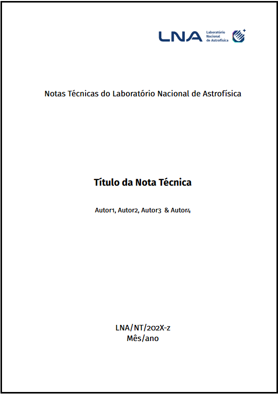

# Modelo latex de notas técnicas do LNA

Neste repositório, você encontra o modelo oficial em LaTeX para a elaboração de Notas Técnicas no Laboratório Nacional de Astrofísica (LNA). O manual tem como principal objetivo padronizar a estrutura e a identidade visual de relatórios e documentos técnicos da instituição, orientando o preenchimento de elementos pré-textuais essenciais, como título, autoria, filiação institucional, resumos e palavras-chave em múltiplos idiomas. Além disso, a publicação organiza as seções fundamentais de um relatório — como introdução, metodologia, resultados e conclusões —, fornecendo diretrizes e exemplos práticos de editoração para a inserção correta de equações matemáticas, tabelas e figuras em conformidade com o padrão gráfico exigido pelo laboratório.

No documento [Modelo LATEX de Nota Técnica do LNA](https://www.gov.br/lna/pt-br/centrais-de-conteudo/publicacoes/public/notastecnicas/lna_nt_2022-22-modelo-latex-de-nota-tecnica-do-lna.pdf), de autoria de Márcio Vital de Arruda, é possível encontrar mais informações e instruções sobre a utilização deste modelo.

  

